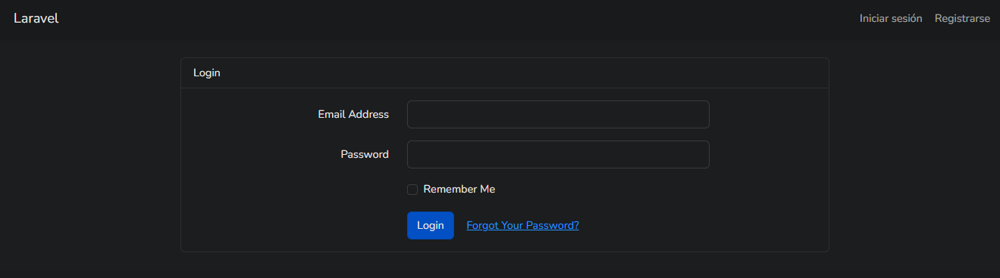
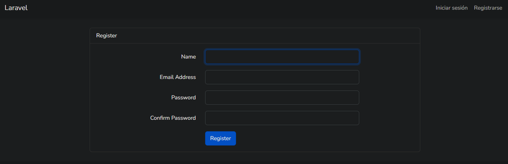
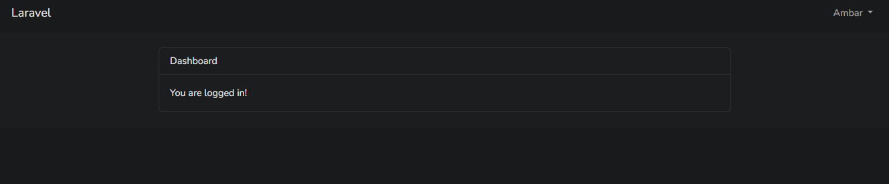
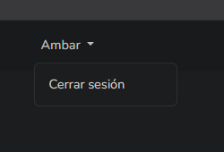
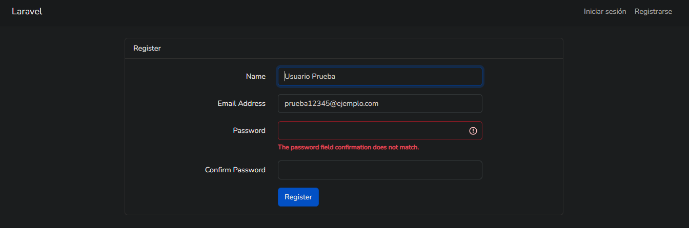
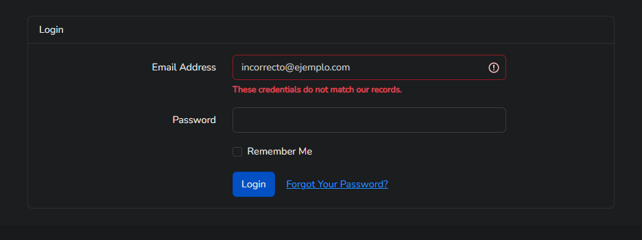

# Laboratorio 2 - Sistema de Login en Laravel

### Desarrollo Web

Estudiante: Ambar Greco  
Profesora: Irina Fong

---

## Introducción

En este laboratorio se desarrolló un sistema de autenticación de usuarios utilizando el framework Laravel y el lenguaje de programación PHP.

El objetivo principal fue implementar un sistema que permitiera a los usuarios registrarse, iniciar sesión y cerrar sesión de manera segura, utilizando las herramientas de autenticación proporcionadas por Laravel.

También se realizaron pruebas para verificar el funcionamiento de los formularios, las validaciones de los datos ingresados y el acceso a las páginas protegidas del sistema.

## Tecnologías utilizadas

- Laravel: Framework PHP utilizado para desarrollar la aplicación web y gestionar la autenticación.
- PHP: Lenguaje utilizado para implementar la lógica del sistema.
- HTML5: Utilizado para estructurar los formularios y las páginas.
- Bootstrap: Utilizado para el diseño y la presentación visual de los formularios.
- MySQL: Sistema gestor de bases de datos utilizado para almacenar la información de los usuarios mediante WAMP.
- Visual Studio Code: Editor utilizado para desarrollar y organizar el código.
- Git y GitHub: Herramientas utilizadas para el control de versiones y almacenamiento del proyecto.

## Funcionamiento del sistema

### 1. Inicio de sesión

Se implementó un formulario de inicio de sesión que permite a los usuarios acceder al sistema mediante su correo electrónico y contraseña.

El formulario también incluye la opción de recordar la sesión y un enlace para recuperar la contraseña.



### 2. Registro de usuarios

Se desarrolló un formulario de registro que permite crear nuevas cuentas dentro del sistema.

El formulario solicita nombre, correo electrónico, contraseña y confirmación de contraseña. Laravel se encarga de validar los datos antes de completar el registro.



### 3. Acceso al Dashboard

Después de iniciar sesión correctamente, el usuario es redirigido al Dashboard del sistema.

En esta página aparece un mensaje que confirma que la autenticación se realizó correctamente.



### 4. Cierre de sesión

Se implementó la opción de cerrar sesión mediante un menú desplegable ubicado en la esquina superior derecha.

Esta funcionalidad permite finalizar la sesión del usuario y regresar al estado de visitante.



### 5. Validación del registro

Se realizaron pruebas para comprobar que el sistema identifica errores durante el registro de usuarios.

Una de las pruebas consistió en introducir dos contraseñas diferentes. Laravel detectó que no coincidían y mostró un mensaje de validación.



### 6. Validación del inicio de sesión

También se comprobó el comportamiento del sistema cuando un usuario intenta iniciar sesión utilizando credenciales incorrectas.

Laravel mostró un mensaje indicando que las credenciales ingresadas no coincidían con los registros almacenados.



## Archivos principales del proyecto

El sistema utiliza diferentes archivos para gestionar la autenticación y la presentación de las páginas.

- `routes/web.php`: Define las rutas principales de la aplicación.
- `app/Http/Controllers/Auth/`: Contiene los controladores relacionados con la autenticación.
- `app/Models/User.php`: Representa el modelo de usuarios.
- `resources/views/auth/login.blade.php`: Contiene el formulario de inicio de sesión.
- `resources/views/auth/register.blade.php`: Contiene el formulario de registro.
- `resources/views/home.blade.php`: Contiene la página principal del usuario autenticado.
- `database/migrations/`: Contiene las migraciones utilizadas para crear las tablas necesarias.

## Ejecución del proyecto

Para ejecutar el proyecto en un entorno local es necesario contar con PHP, Composer y Node.js.

Una vez descargado el repositorio, se deben instalar las dependencias de PHP:

```bash
composer install
```

Posteriormente, instalar las dependencias de JavaScript:

```bash
npm install
```

Crear el archivo `.env` a partir de `.env.example`, configurar la conexión con la base de datos y generar la clave de la aplicación:

```bash
php artisan key:generate
```

Ejecutar las migraciones:

```bash
php artisan migrate
```

Compilar los recursos:

```bash
npm run build
```

Finalmente, iniciar el servidor:

```bash
php artisan serve
```

La aplicación podrá utilizarse desde la dirección local indicada por Laravel, normalmente `http://127.0.0.1:8000`.

## Conclusión

Mediante el desarrollo de este laboratorio se logró implementar un sistema de autenticación utilizando Laravel, permitiendo comprender el funcionamiento del registro de usuarios, el inicio de sesión, el cierre de sesión y las validaciones de los formularios.

Las pruebas realizadas permitieron comprobar el comportamiento del sistema tanto con datos correctos como con información incorrecta, demostrando la importancia de las validaciones para controlar el acceso de los usuarios.

Este laboratorio permitió fortalecer los conocimientos relacionados con el desarrollo web utilizando PHP, Laravel, bases de datos y herramientas de control de versiones como Git y GitHub.
